# Architecture

This document records the architecture of Workspace for AI collaboration, and [the product vision](../product-vision.md) is the scope it serves.

## Container View

The product runs as the containers below.

### Container Responsibilities

| Container  | Responsibilities                                                                                                                                                                                          |
| ---------- | --------------------------------------------------------------------------------------------------------------------------------------------------------------------------------------------------------- |
| `frontend` | Renders the board, its blocks, and an AI block's messages panel; polls the backend for the board's blocks and messages; holds a block's unsaved edits until they are sent                                 |
| `gateway`  | Exposes the product on one public port; routes `/api` requests to the backend and every other request to the frontend; owns the routing rules and the AI reply timeout                                    |
| `backend`  | Serves the board, block, connection, and message API; sends an AI block's conversation to the LLM service provider and stores the reply; owns the boards, the blocks, their connections, and the messages |
| `database` | Stores the boards, the blocks, their connections, and the messages; keeps them in a volume, so they survive a restart                                                                                     |

## Diagrams And Legends

Solid boxes are containers, the cylinder is a data store, and the dashed box is an external system.
An arrow is one exchange, pointing from the container that sends the request, and labelled with what crosses it.
The `gateway` is the `nginx` service in [`app/docker-compose.yml`](https://github.com/WellMadeTeam/workspace-ai-03/blob/main/app/docker-compose.yml); the other containers keep their service names, and the `database` is the SQLite file in its `backend-data` volume.

The image is [`container.svg`](./container.svg), rendered with [Mermaid](https://mermaid.js.org/) from its source [`container.mmd`](./container.mmd).
