# Architecture

This document records the architecture of Workspace for AI collaboration, and [the product vision](../product-vision.md) is the scope it serves.

## Drivers

- **Business goals:** [the threshold of success](../threshold-of-success.md) holds the goals the architecture serves.
- **Constraints:** the product vision's [constraints section](../product-vision.md#constraints) holds the conditions the architecture lives inside.
- **Functional requirements:** the [functional requirements index](../functional-requirements/README.md) holds the behavior the architecture must deliver.
- **Quality requirements:** the [quality requirements index](../quality-requirements/README.md) holds the quality the architecture must meet, and it is also the priority matrix.

## Container View

The product runs as the containers below, and [`ADR-001`](adr/ADR-001.md) decides that split and the stack it runs on.
The team self-hosts the OpenPanel and OpenObserve backends but does not build them.

### Container Responsibilities

| Container  | Responsibilities                                                                                                                                                                                          |
| ---------- | --------------------------------------------------------------------------------------------------------------------------------------------------------------------------------------------------------- |
| `frontend` | Renders the board, its blocks, and an AI block's messages panel; polls the backend for the board's blocks and messages; holds a block's unsaved edits until they are sent                                 |
| `gateway`  | Exposes the product on one public port; routes `/api` requests to the backend and every other request to the frontend; owns the routing rules and the AI reply timeout                                    |
| `backend`  | Serves the board, block, connection, and message API; sends an AI block's conversation to the LLM service provider and stores the reply; owns the boards, the blocks, their connections, and the messages |
| `database` | Stores the boards, the blocks, their connections, and the messages; keeps them in a volume, so they survive a restart                                                                                     |

## Diagrams And Legends

Solid boxes are containers, the cylinder is a data store, and the dashed box is an external system.
An arrow is one exchange, pointing from the container that sends the request, and labelled with what crosses it.
The team self-hosts the OpenPanel and OpenObserve backends but does not build them.
The `gateway` is the `nginx` service in [`app/docker-compose.yml`](https://github.com/WellMadeTeam/workspace-ai-03/blob/main/app/docker-compose.yml); the other containers keep their service names, and the `database` is the SQLite file in its `backend-data` volume.

The image is [`container.svg`](./container.svg), rendered with [Mermaid](https://mermaid.js.org/) from its source [`container.mmd`](./container.mmd).

## Architectural Decisions

See the [ADR index](adr/README.md) for the architectural decisions.
